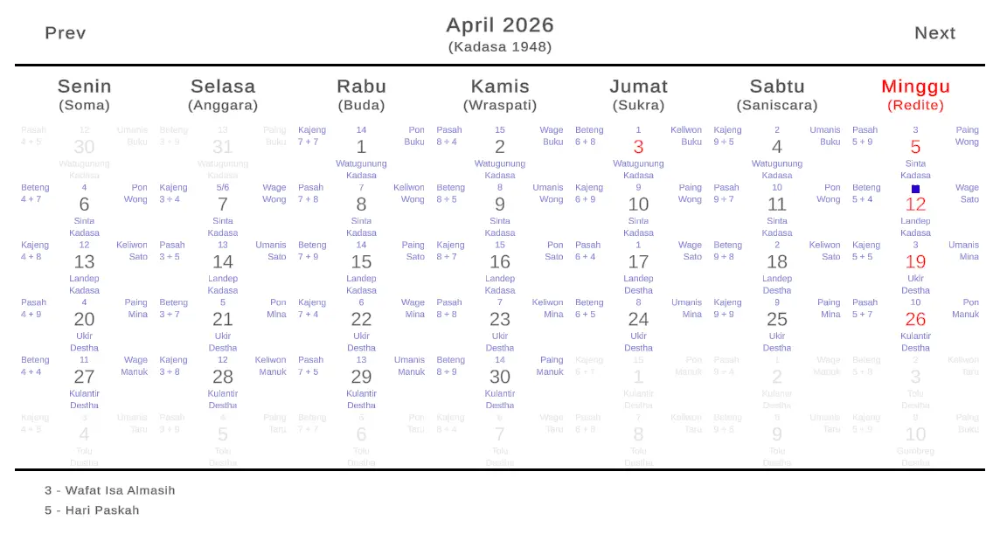

# Balinese Calendar UI

[](https://openupm.com/packages/com.adityarahmanda.balinese-calendar-ui/)

## Summary
An implementation of the Aditya Rahmanda's [Calendar UI](https://github.com/adityarahmanda/unity-calendar-ui) package tailored for the Balinese Saka calendar.



## Features
- Gregorian Calendar Display - Shows Gregorian calendar year, month, day and holiday infomation views.
- Balinese Saka Calendar Display - Shows Balinese calendar daka year, sasih, sasih day, triwara, pancawara, pancawara + saptawara urip, ingkel and wuku views.

## Installation

### Install via Clone

Clone this project using this command line

```
git clone https://github.com/adityarahmanda/unity-balinese-calendar-ui.git
```

### Install via Scoped Registry

1. In Unity, Open `Edit -> Project Settings -> Package Manager`

2. Add a new Scoped Registry (or edit the existing OpenUPM entry)

    |Label|Value|
    |----|----|
    |Name|Aditya Rahmanda|
    |URL|https://package.openupm.com|
    |Scope(s)|com.adityarahmanda|

3. Click `Save` or `Apply`

4. Open Window/Package Manager

5. There are several ways to add the package

    - Go to My Registries section, 
    - Find `Aditya Rahmanda`'s `Balinese Calendar UI` package 
    - Click `Install` Button
  
    or

    - Click `+`
    - Select `Add package by name...`
    - Paste `com.adityarahmanda.balinese-calendar-ui` into name
    - Click Add
